# Alternative modes and Multi game

## Alternative modes

The in-game menu's first row, **Alternative modes**, has ways of playing and watching a fighting game that the
board doesn't have. Each has a page with a Start row and its own choices, and runs until another is started or the
menu's Reset game. Which modes a game has is on its own page.

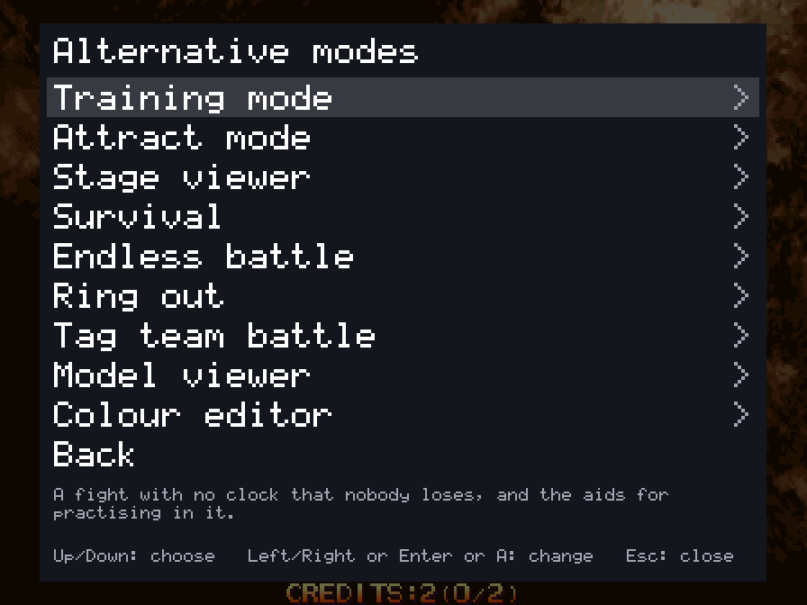

### The stage

The in-game menu's **Stage** page (on its first page, after Game) says where the fights are: the game's own choice, or
a stage by name, the game's own or another game's whose ROM set you have. It holds whatever is played: the board's own
one- and two-player games, training, survival, the team battle and the endless battle's **One stage** (its **Shuffle**
and **Scroll** go through the stages their own way, as the ring out does). Online the match is on the host's. Confirm
on its row marks a favourite; the row under it goes through the favourites alone.

A one-player game's opponents come as the board has them, on the stage chosen; a last opponent that is part of its
stage keeps it (Apocalypse, Onslaught). In the Street Fighter II games, Night Warriors and Darkstalkers the stage is the
opponent's own and the game goes by it, so their one-player game keeps its stages: only another game's stage is shown
there.

### Training mode

A fight with no clock that nobody loses, and the training aids: [training mode](TRAINING.md).

### Survival

One computer opponent after another on the health you have left. How many can you beat?

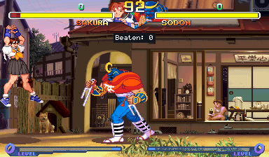

### Endless battle

Two fighters the game plays, for as long as you like, with no bars and no clock: on one stage, on stages that fade
one into another, or on a floor that scrolls through them all. Touch the controls to take a fighter over.

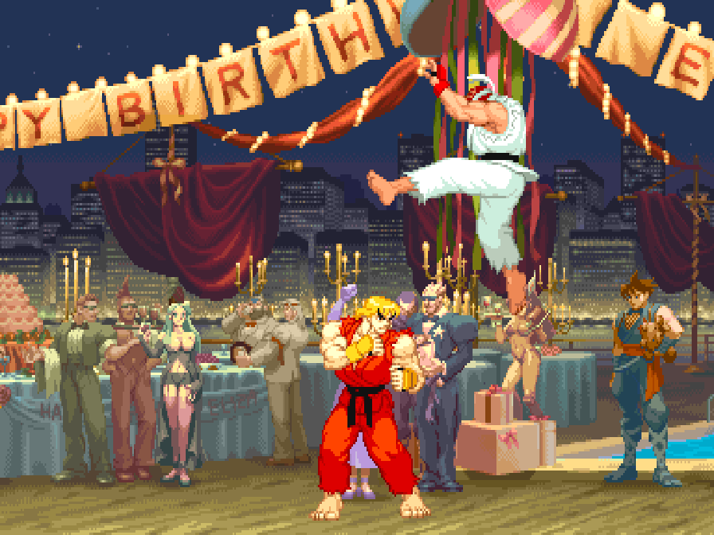

### Ring out

No health. Knock your opponent off the end of the stage, then jump down after them and land on the next stage. The
computer plays it as a ring out too.

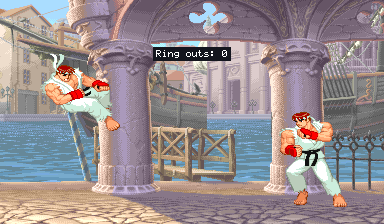

### Ball battle

In the Vampire Savior games (Vampire Savior, its Definitive version, Vampire Savior 2, Vampire Hunter 2). A ball game: a line splits the stage in two and each fighter keeps to
a half. Hit the big ball with your attacks, harder ones sending it faster and where you strike it deciding the angle,
past the other fighter and off their end for a point. Three hits in a row make a power shot; a power shot or a super
into a fighter knocks them down. First to 3, 5 or 10, against the CPU or player 2, and the camera follows the play
([more](COURT.md)).

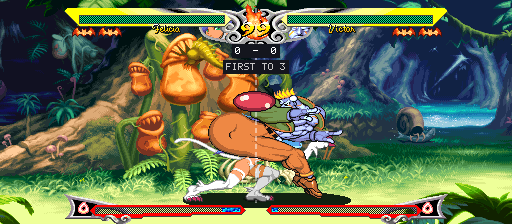

### Tag team battle

In every fighting game but Alpha, Pocket Fighter and Marvel Super Heroes. Two teams of two or three. In the
knock-out style one fighter of each team is on at a time, and the next comes on at a knock-down. In the tag style
(Marvel-style) you tag the next one in with the left trigger, and resting fighters get some health back. Play
co-op against the computer's team, or 2 vs 2 for four players.

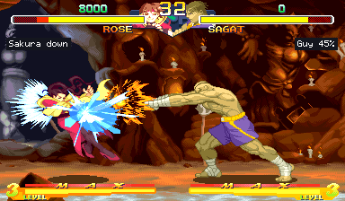

### Stage viewer

Any stage with nobody on it, scrolled with the stick or by itself, with any tune.

**Save whole stage** saves the stage chosen from one end to the other, in a folder of its own in `exports/stages/`:
each of its layers in full (as the scene export splits them, [more](FEATURES.md#scene-export)), and `stage.png`, all
of them put together. The viewer goes to the stage's left end and across to its right, about ten seconds, and each
frame's layers are put in place: a scroll screen by where it is in its map on each line (a floor's lines each at their
own pace, so the floor comes out flat), objects by how far their picture moved. A stage's planes go at different
paces, so there is no one right picture of all of them: `stage.png` has each where it is with the camera in the
middle, and `stage.json` gives each layer's pace (its pixels moved for each of the camera's: the far sky about 0.2,
the floor 1) and its place in `stage.png`. **Show stages folder** opens `exports/stages` in your file manager.

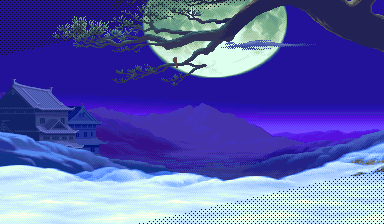

### Model viewer

One character by itself at any size, on a stage or on plain white or black, moved with your controls or going through
its animations.

**Save picture** saves the character as shown, by itself on a see-through background, as a PNG. **Save animation**
saves every frame of the animation shown in a folder of its own: each frame as a PNG, a sheet of all of them, a looping
animated PNG and GIF with the game's own timing, and `animation.json` (each frame's time in sixtieths of a second, and
where the character stands in the frames). They are on the viewer's **Export** page, and go in `exports/` beside your saves, at the **Export size** chosen (1x
to 16x, the board's pixels kept square). The animated PNG and GIF play at the viewer's **Speed**. **Show pictures folder** opens that folder.

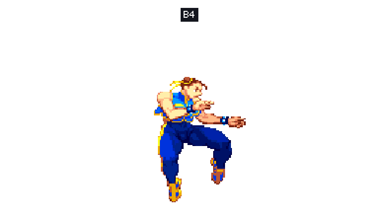

### Colour editor

Change a character's colours while you watch, and keep them for that character.

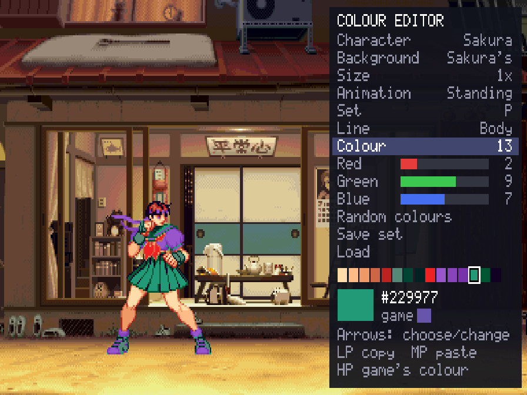

### Attract mode

The game's own show on a loop: everything, the introduction only, or one demonstration fight after another.

### The beat-'em-ups

Alien vs. Predator and Cadillacs and Dinosaurs have their own modes: three players at once, a stage to start at, a
score attack, and the stage and model viewers.

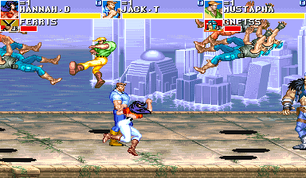

### The shoot-'em-ups

Giga Wing, Progear and Dimahoo have a shooter's modes instead:

- **Training mode**: any stage, from its start or straight at its boss, with the fighter (in Progear the pilot and gunner, in Dimahoo the character),
  ships, bombs and power you choose. Backspace (a gamepad's left shoulder) puts it back as it began at once; Backslash (the left trigger with the
  left shoulder) replays your last attempt, until you touch the controls. Its aids show the scoring or the power as it
  happens and a summary at each boss and stage end. Slow motion and frame advance are the menu's speed and pause. [All
  about training mode →](PRACTICE.md)
- **Hit boxes**, on the Cheats page and in every mode: each ship's true hit box, the enemies' bodies and the point of
  every enemy shot, each a switch of its own.
- **Score attack**: one credit, no continue, no cheats; the best score is kept.
- **Caravan**: a score attack against the clock: two, three or five minutes, a ship for every one lost; the best score
  is kept for each length.
- **Boss rush**: every boss in turn, the way between them run unseen; the best score and its time are kept.
- **Stage viewer**: a stage scrolling by with nobody on it, at the speed you choose; up or right scrolls it faster,
  down or left back the way it came, and the shot button stops it.
- **Slowdown** (the Game page): arcade perfect, as the board slows (the default), or none, the processor overclocked.

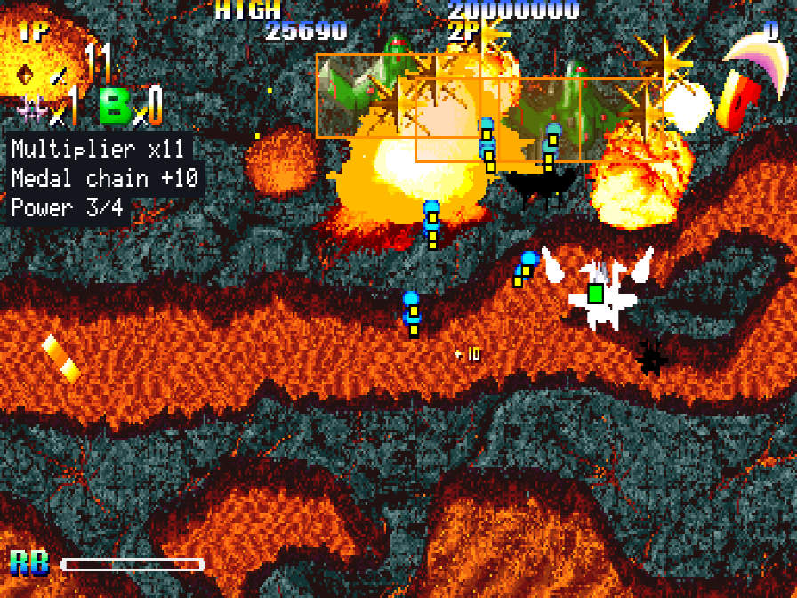

## Multi game

**Multi game** (the page after Controllers) plays several games one after another, for as long as you like. Its
**Endless battle** goes through every stage of a fighting game with the game playing both fighters, then on to the
next game's stages, and round again after the last: choose the games (every fighting game, or only some), their order
(the sidebar's, or shuffled), how the stages change (**Shuffle**, each fading into the next after the time you choose,
or **Scroll**, going by in order at the speed you choose), the **Screen** (every game full screen, every game in a
window, or as each game is set), the **Picture** (every game widescreen, every game 4:3, or as each game is set) and
the rest of the Display page every game has (**Invisible walls**, **Scaling**, **Picture shape**, **Window size**,
**Shader**, each also as each game is set) and the **Zoom** (**Both fighters**: in every game the camera follows the
two fighters, as close as they allow; **By distance**: closer as they come together, out as they part, the health bars
left as they are), then **Start**. These are for that run only: each game's own settings stay as they
were. In a window, each game opens where the one before it was and as large, wherever you moved it. Touch
the controls to take a fighter over. While it plays, **N** (or a gamepad's left shoulder) fades out to the next game
and **F** (or the left trigger) held fast-forwards at four times the speed; the page lists them under **While it
plays**. Quitting a game (its menu's Quit game, or closing its window) ends the run, as does **Stop after this
game**.

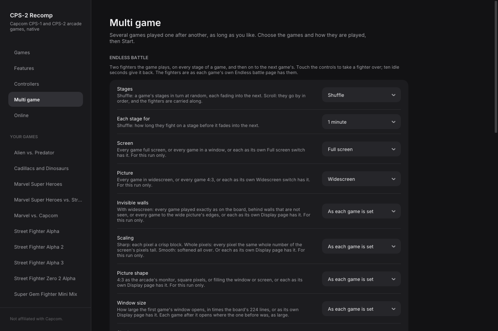
