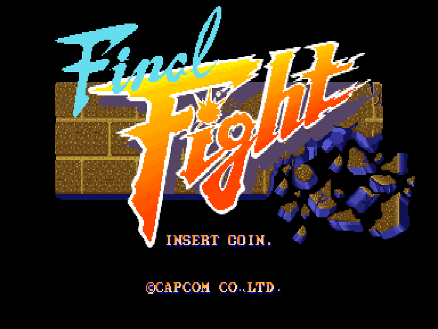
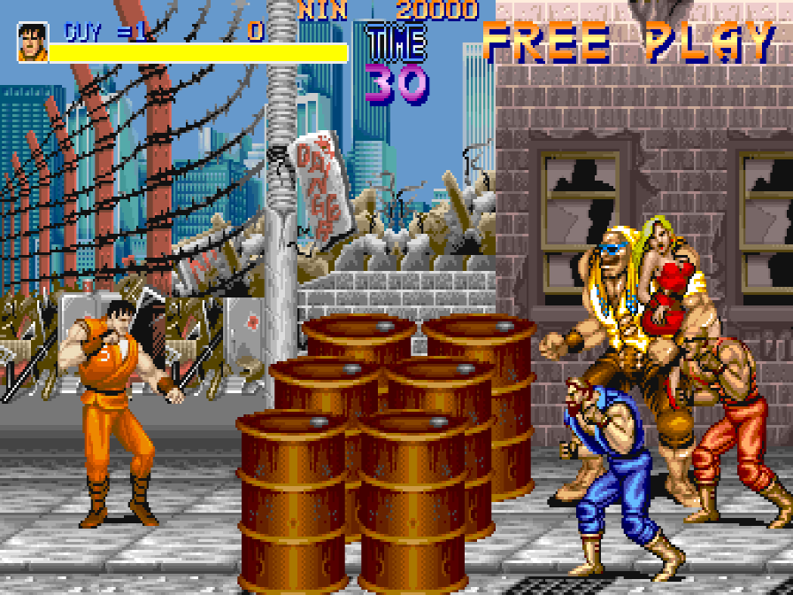

# Final Fight Recomp

> Part of **[CPS-2 Recomp](../../README.md)**: one download and one launcher for every Capcom arcade game this
> project has ported. This page is about Final Fight; the [main page](../../README.md) says how to
> download and play.

An unofficial native PC port of the arcade game *Final Fight* (Capcom, 1989, classic CPS-1 board) for macOS,
Linux (Steam Deck included) and Windows, made by static recompilation: a beat-'em-up for up to two players, with
free play, a stage to start at, score attack, attract mode show selection, stage viewer, the board's DIP settings,
a custom soundtrack and cheats.

> **Beta.** The game plays through its first stage in made-up play and its code is checked instruction by instruction,
> including GPU rendering and rollback/online checks, though a full playthrough by hand has not been tested yet.

**No game files are included.** You need your own copy of the game: the arcade ROM set `ffight` (World, set 1), from
a board you own. This project cannot help you get one.

This project is not affiliated with, endorsed by, or sponsored by Capcom. *Final Fight* is a trademark of Capcom.

## What it is

The game's 68000 program and Z80 sound program are translated ahead of time into C++ and compiled into the port.
What the program expects of the board is code written for this project, not an emulator: the CPS-1's video
(its objects among the scroll screens, as its CPS-B-04 layer control orders them), its inputs for two players,
its DIP switches, and YM2151 + OKI MSM6295 sound.

- **Two players at once**, each with a keyboard layout or a gamepad of their own.
- **Play options**: free play, straight to the title screen, and start at any stage (Stages 1–6 or Bonus 1–2).
- **Alternative modes**: attract mode with selectable shows (everything, story only, demonstrations only, or title & rankings),
  score attack (one credit, continues off), and a stage viewer covering all 18 areas.
- **Board settings**: the DIP switches on the Board page (Difficulty 1 & 2, Lives, Bonus life, Continue, Demo sound,
  2 coins to start); all but Demo sound take effect after Reset, as on the board.
- **Custom soundtrack**: 19 music tracks mapped (`music.cpp`).
- **Cheats**: infinite health, infinite lives, and infinite time.
